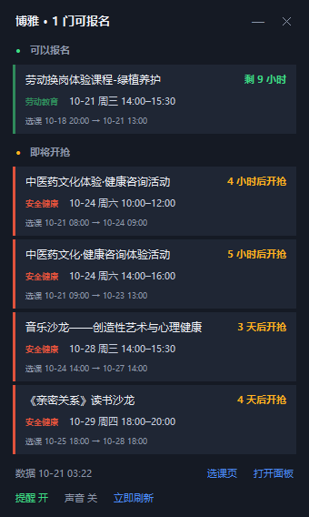
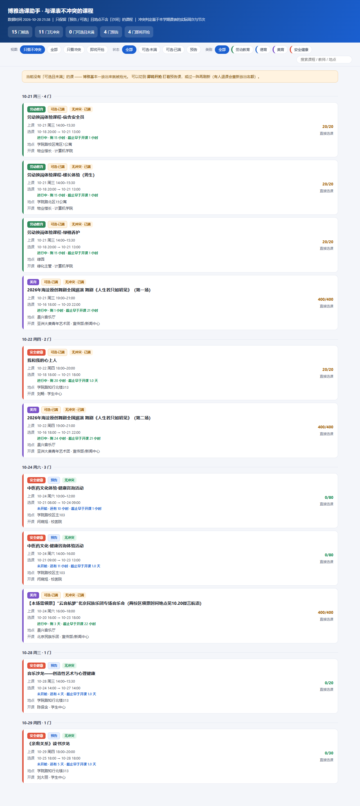

# 博雅选课助手（北航 BUAA）

自动登录**博雅选课系统**和**教务系统**，筛出「状态是预告/可选、地点不在沙河、且与本人课表不冲突」的课程，
用一个**桌面小组件**盯着名额，配一个**单文件 HTML 面板**看全量列表。

> 纯个人学习项目，只读不抢。适用于 Windows 10/11。



## 它想解决什么

- 博雅课程名额少，放出来几分钟就没了，靠人盯不现实
- 选课页面按时间列出 120 门课，但不会告诉你**哪几门和你现在的课表冲突**
- 系统里的「可选」只表示选课窗口开着，**不代表还有名额**（经常是 400/400）

所以这个工具做三件事：**把数据抓下来 → 和课表算冲突 → 用不打扰的方式提醒你**。

## 功能

- **自动登录**：走学校统一身份认证（CAS），账号密码用 Windows DPAPI 加密存本地，只有本机本用户能解
- **全量采集**：自动翻完所有分页（实测 6 页 / 120 门）
- **冲突判定**：按课表里真实的周次（支持 `[6周,9周,12周,15周]` 这种零散周）、节次区间，和博雅课的绝对时间求交
- **派生状态**：`可选·未满` / `可选·已满` / `预告`，一眼看出哪些真能报
- **桌面小组件**：不挡应用（压在最底层）、每小时静默刷新、新名额弹出置顶提醒、可最小化
- **HTML 面板**：按日期分组、类别配色、状态与类别筛选、搜索

## 界面

**桌面小组件**（常驻右下角，被别的窗口挡住时不影响使用）：

| 展开 | 最小化 |
|---|---|
|  |  |

**完整面板**（双击小组件或打开 `out/boya.html`）：



## 快速开始

### 环境要求

- Windows 10 / 11
- Python 3.10+（安装时勾选 **Add python.exe to PATH**）
- Microsoft Edge（系统自带）

### 安装

```bat
git clone https://github.com/<你的用户名>/buaa-boya-helper.git
cd buaa-boya-helper
python -m pip install -r requirements.txt
```

如果 `pip install` 因为网络问题失败，可以改用清华镜像手动解包（不需要 pip）：

```bat
python tools\vendor_playwright.py
```

### 第一次使用

双击 **`1-首次登录.bat`**，按提示输入学工号和密码（密码输入时不回显）。

脚本会打开一个 Edge 窗口自动登录，验证成功后把凭据用 **DPAPI** 加密写到 `secrets/cred.bin`，
之后所有程序都直接复用，不需要再输。

### 日常使用

| 文件 | 作用 |
|---|---|
| `桌面小组件.bat` | 启动桌面小窗（推荐设成开机自启） |
| `一键刷新.bat` | 手动刷新一次，并打开完整面板 |
| `安装开机自启.bat` | 在启动目录创建快捷方式，开机自动运行小组件 |
| `取消开机自启.bat` | 移除开机自启 |

**课表数据只需要抓一次**（`data/byxt_grid_term.json`）。之后加退课了，重跑一次 `5-全量采集.bat`。

## 工作原理

### 1. 登录：CAS + iframe

`bykc.buaa.edu.cn` 会 302 到 `sso.buaa.edu.cn`，登录表单在 iframe（`cas/login-normal.html`）里，
真正的提交逻辑是页面自己的 JS：

```python
frame = next(f for f in page.frames if "login-normal" in f.url)
frame.fill("#unPassword", username)
frame.fill("#pwPassword", password)
frame.evaluate("loginPassword()")     # 调页面自己的函数，比点按钮稳
```

博雅和教务是两个独立会话，所以两个都要登录一次（同一个账号密码）。

### 2. 采集：为什么不用接口

博雅的接口是**加密**的，请求/响应都是密文：

```
POST /sscv/queryNewsList
请求体: GmUOM0iVuGS0XuQLgascdw==
响应体: "1uYRdiD2hiJnHJYULpPRVY1LgyohZ3ew9cvv0OQC..."
```

前端用 RSA + AES 做的，硬解协议既脆弱又没必要。所以改成读**页面自己的状态**：

```python
# Angular 把数据挂在 scope 上，直接拿结构和分页信息
angular.element(document.querySelector('table')).scope().vm.pageInfo
# → {'currentPage': 1, 'itemsPerPage': 20, 'totalPages': 6, 'totalElements': 120}
```

再配合 DOM 兜底（`table tbody tr` → 每行 10 个单元格），翻页用 `selectPage(n)` 并等待表格真的重绘。

### 3. 冲突判定

博雅课给的是绝对时间（`2026-10-30 18:00 → 20:30`），课表给的是「周次 + 星期 + 节次」。
把后者展开成具体日期和时段，再求交：

```
上课时间 ∩ 某节课 = ∅  → 不冲突
```

节次时间表（每节 45 分钟）：

| 节次 | 时间 | 节次 | 时间 |
|---|---|---|---|
| 1 | 08:00 | 8 | 15:50 |
| 2 | 08:50 | 9 | 16:40 |
| 3 | 09:50 | 10 | 17:30 |
| 4 | 10:40 | 11 | 19:00 |
| 5 | 11:30 | 12 | 19:50 |
| 6 | 14:00 | 13 | 20:40 |
| 7 | 14:50 | 14 | 21:30 |

### 4. 展示

- **HTML 面板**：生成时把数据直接内嵌进 `<script>`，双击就能开，不依赖服务器
- **桌面小组件**：Tkinter 画的，无边框 + `toolwindow`，被点击抬起后 1.5 秒自动压回
  z-order 最底层（`SetWindowPos(HWND_BOTTOM)`），所以永远不会挡住别的应用
- **提醒**：独立进程弹一个 `-topmost` 的小窗，不受小组件层级影响

## 目录结构

```
一键刷新.bat              抓取 + 生成 + 打开面板
桌面小组件.bat            启动置顶小窗（pythonw，无控制台）
1-首次登录.bat            交互式输入账号密码
安装开机自启.bat / 取消开机自启.bat
src/
  _boot.py                路径与临时目录
  util.py                 日志
  dpapi_store.py          DPAPI 加解密（ctypes，无需 pywin32）
  creds.py                凭据存取
  login.py                启动 Edge + 统一身份认证登录
  step1_login.py          首次登录
  step5_boya_pages.py     博雅全量列表抓取
  make_panel.py           解析 + 冲突判定 + 生成 HTML/JSON
  refresh.py              后台刷新（无头）
  desktop_widget.py       桌面小组件
  alert_popup.py          置顶提醒框
  desktop_layer.py        桌面层挂载实验（Win11 上不可用，保留参考）
  step2~step4_*.py        开发期的抓包探查脚本
tools/
  install_autostart.ps1   开机自启
  vendor_playwright.py    离线装 Playwright
data/                     抓取结果与日志（不入库）
out/                      生成的面板（不入库）
secrets/cred.bin          DPAPI 加密的凭据（不入库）
```

## 数据与隐私

- 账号密码用 **Windows DPAPI** 加密，只有当前 Windows 用户 + 当前机器能解密，文件拷走无效
- 密码不会写进日志，也不会出现在任何抓取结果里
- 所有抓取数据、截图、浏览器会话都在本地，`.gitignore` 已排除
- 脚本**只读**：只请求列表和课表接口，不会点选课/退课

想彻底清除：删掉 `secrets/cred.bin` 和 `.browser-profile/`。

## 已知限制

- **仅 Windows**：依赖 DPAPI、Tkinter 窗口层级、bat 脚本
- **必须有界面**：站点会对 `HeadlessChrome` 的 UA 返回 403，所以交互时带窗口；后台刷新用无头 + 普通 UA
- **桌面层挂不上**：Windows 11 24H2 之后没有 Win10 那个壁纸层 `WorkerW`，`SetParent` 到 `Progman` 会被拒，
  因此改用「永远压在最底层」近似
- **系统通知**：`CreateToastNotifier` 需要 AppUserModelID，未打包程序会被拒（`0x80073D54`），
  所以提醒改为应用内弹出
- 教务的课表结构如果改版，`make_panel.py` 里的解析可能要跟着调

## 常见问题

**Q：提示 profile 被占用？**
A：先关掉所有由本工具打开的 Edge 窗口（后台刷新最多占 7 分钟）。

**Q：小组件不见了？**
A：它被压在最底层，按 `Win+D` 或最小化其它窗口就能看到。重复双击不会开第二个窗口（单实例锁）。

**Q：想换账号？**
A：删掉 `secrets/cred.bin` 和 `.browser-profile/`，重跑 `1-首次登录.bat`。

**Q：数据多久更新一次？**
A：小组件每小时静默刷新一次；也可以点组件里的「立即刷新」。

## 免责声明

- 仅供个人学习与自用，请遵守学校关于选课系统的使用规定
- 不提供任何"抢课/代抢"能力，也不绕过任何验证码或风控
- 使用者需自行承担因高频访问、账号异常等带来的风险
- 与北京航空航天大学官方无关

## License

[MIT](LICENSE)
